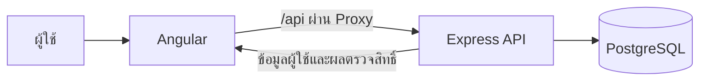
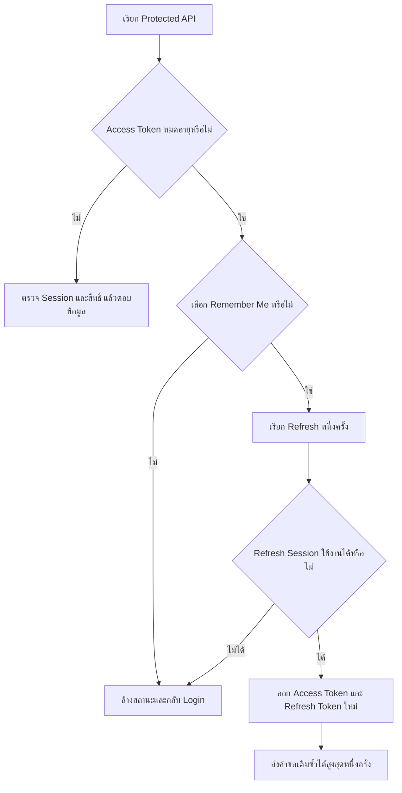

# Authentication & Role-Based Access System

โปรเจกต์ระบบเข้าสู่ระบบด้วย Angular, Node.js + Express และ PostgreSQL เพื่อสาธิตการยืนยันตัวตน การจัดการ Token และ Session รวมถึงการแยกสิทธิ์ระหว่าง Admin และ User

เอกสารนี้อธิบายการทำงานเป้าหมายตาม [แผนออกแบบระบบ](SYSTEM_DESIGN_PLAN.md) ซึ่งอ้างอิงจาก [ข้อกำหนดโครงการ](Doc.txt) ส่วนที่ระบุว่าเป็นแผนยังต้องพัฒนาเพิ่มเติม ไม่ใช่ความสามารถที่เสร็จแล้วทั้งหมด

## ภาพรวมระบบ

ระบบแบ่งเป็น 3 ส่วน:

| ส่วน | เทคโนโลยี | หน้าที่ |
| --- | --- | --- |
| Frontend | Angular + TypeScript | หน้า Login, Dashboard, สถานะผู้ใช้ และการขอ Token ใหม่ |
| Backend | Node.js + Express + TypeScript | ตรวจข้อมูลเข้าสู่ระบบ ออก Token ตรวจสิทธิ์ และเพิกถอน Session |
| Database | PostgreSQL | เก็บผู้ใช้ Password Hash, Session และประวัติ Refresh Token ตามแผน |



Frontend ใช้ Route Guard เพื่อจัดหน้าจอให้เหมาะกับผู้ใช้ ส่วน Backend ตรวจสิทธิ์ทุกครั้งก่อนให้เข้าถึง API ที่ได้รับการป้องกัน

## บัญชีทดสอบ (โหมดทดลอง)

ใช้ข้อมูลต่อไปนี้สำหรับทดสอบการเข้าสู่ระบบและการแสดง Dashboard ตาม Role

| Role | Email | รหัสผ่าน |
| --- | --- | --- |
| User | `user@rich.demo` | `Demo123!` |
| Admin | `admin@rich.demo` | `Demo123!` |

ทั้งสองบัญชีใช้รหัสผ่านเดียวกัน: `Demo123!`

วิธีทดสอบ: เข้าสู่ระบบด้วยแต่ละบัญชี ตรวจว่าแสดง Dashboard ตรงตาม Role แล้วทดสอบ Remember Me ทั้งแบบเลือกและไม่เลือกตามหัวข้อวิธีตรวจรับด้านล่าง

ข้อมูลบัญชีนี้เป็นข้อมูลโหมดทดลองที่ระบุไว้สำหรับทดสอบ การบันทึกใน README ไม่ได้สร้างบัญชีในฐานข้อมูล ต้องเตรียมบัญชีหรือรัน Seed ของระบบก่อนใช้งาน

## ขอบเขตโปรเจกต์

- Login ด้วยบัญชีตัวอย่าง Admin และ User
- แสดงชื่อและ Role ของผู้ใช้ที่เข้าสู่ระบบ
- แสดง Dashboard ตาม Role
- รองรับ Remember Me และการหมดอายุของ Token
- Logout พร้อมเพิกถอน Session
- แสดง Loading และข้อความผิดพลาดตามสถานการณ์

งานนี้ไม่รวมหน้าสมัครสมาชิก ลืมรหัสผ่าน ระบบจัดการผู้ใช้เต็มรูปแบบ และ Dashboard ที่มีข้อมูลซับซ้อน แม้ Backend เดิมจะมี API สมัครสมาชิกอยู่แล้ว

## ลำดับการทำงานตามแผน

### 1. เข้าสู่ระบบ

1. ผู้ใช้กรอก Email, Password และเลือก Remember Me
2. Angular ตรวจข้อมูลเบื้องต้น แสดง Loading และป้องกันการกดส่งซ้ำ
3. Backend ตรวจข้อมูล ตรวจ Password Hash และตรวจว่าบัญชียังใช้งานได้
4. เมื่อข้อมูลถูกต้อง Backend สร้าง Session และออก Access Token
5. หากเลือก Remember Me จะสร้าง Refresh Token และตั้ง Cookie เพิ่มด้วย
6. Angular เก็บ Access Token ในหน่วยความจำ พร้อมข้อมูลผู้ใช้ แล้วเปิด Dashboard ตาม Role

ถ้าเข้าสู่ระบบไม่สำเร็จ ให้แสดงข้อความกลาง เช่น “Email หรือรหัสผ่านไม่ถูกต้อง” โดยไม่เปิดเผยว่ามีบัญชีดังกล่าวหรือไม่

### 2. แสดงหน้าจอตาม Role

| Role | หน้าจอเป้าหมาย | สิทธิ์ |
| --- | --- | --- |
| Guest | `/login` | ส่งคำขอเข้าสู่ระบบ |
| User | `/user` | ดูข้อมูลตนเองและ User Dashboard |
| Admin | `/admin` | ดู Admin Dashboard และเรียก API สำหรับ Admin |

Admin เห็นข้อความต้อนรับและส่วนจัดการระบบ ส่วน User เห็นข้อความต้อนรับและส่วนข้อมูลส่วนตัว

Backend อ่าน Role ปัจจุบันจากฐานข้อมูล การแก้ Role ใน Browser จึงไม่ทำให้ผู้ใช้ได้รับสิทธิ์ Admin หาก User เรียก API ของ Admin โดยตรง ระบบตอบ `403 Forbidden`

### 3. เรียก API หลัง Login

1. Angular Interceptor แนบ Access Token เป็น `Authorization: Bearer <token>` เฉพาะ API ของระบบ
2. Backend ตรวจลายเซ็น อายุ และข้อมูลกำกับของ JWT
3. Backend ตรวจว่า Session ยังไม่หมดอายุหรือถูกเพิกถอน และบัญชียังใช้งานได้
4. API ที่จำกัด Role ตรวจสิทธิ์จากฐานข้อมูลเพิ่มก่อนส่งข้อมูลกลับ

### 4. Remember Me และอายุ Token

ค่าต่อไปนี้เป็นนโยบายที่เสนอในแผน ยังไม่ใช่พฤติกรรมของโค้ดเดิมทั้งหมด

| นโยบาย | ไม่เลือก Remember Me | เลือก Remember Me |
| --- | --- | --- |
| Access Token | 15 นาที | 15 นาที |
| อายุ Session สูงสุด | 15 นาที | 30 วันนับจาก Login |
| Refresh Token | ไม่มี | มี |
| Access Token หมดอายุ | กลับหน้า Login | ขอ Token ใหม่หาก Session ยังใช้ได้ |
| รีโหลดหน้า | กลับหน้า Login เพราะ Token ใน memory หาย | ใช้ Refresh Cookie คืนสถานะ |

สำหรับ Demo เสนอให้ใช้ Access Token อายุ **60 วินาที** และ Refresh Session อายุ **5 นาที** เพื่อทดสอบได้รวดเร็ว

Access Token เก็บในหน่วยความจำของ Angular ไม่เก็บใน localStorage หรือ sessionStorage ส่วน Refresh Token เก็บใน HttpOnly Cookie โดยใช้ Secure เมื่อให้บริการผ่าน HTTPS และกำหนด SameSite/Path ตามแผน ฐานข้อมูลเก็บเฉพาะ Hash ของ Refresh Token

การ Refresh ไม่เลื่อนวันสิ้นสุด Session ออกไป และ Access Token ใหม่ต้องไม่อยู่ได้นานกว่า Session ที่เหลือ

### 5. ต่ออายุ Token อัตโนมัติ



หาก API หลายคำขอหมดอายุพร้อมกันในแท็บเดียว ให้รอผล Refresh ร่วมกัน เพื่อไม่ส่ง Refresh ซ้ำ ระบบต้องไม่ Refresh จากคำขอ Login, Refresh, Logout หรือจากข้อผิดพลาด `403`

Refresh Token ที่ใช้แล้วจะถูกแทนด้วย Token ใหม่ หากพบการนำ Token เก่ากลับมาใช้ซ้ำ Backend จะเพิกถอน Session ทั้งชุด โดยใช้ Transaction และ Row Lock ป้องกันการหมุน Token พร้อมกันในฐานข้อมูล

### 6. กลับมาเปิดระบบ

เมื่อเริ่ม Angular ให้แสดงสถานะกำลังตรวจสอบ Session และเรียก Restore ผ่าน Refresh Endpoint หนึ่งครั้ง หากมี Refresh Cookie ที่ยังใช้ได้ ระบบจะคืนข้อมูลผู้ใช้และ Token ใหม่

หากไม่มี Refresh Session ให้แสดงหน้า Login การไม่เลือก Remember Me จึงต้อง Login ใหม่หลังรีโหลดตามนโยบายของแผน ไม่รับประกันการตรวจจับการปิด Browser เพราะ Browser อาจกู้คืนสถานะเดิมได้

### 7. ออกจากระบบ

1. Angular ส่งคำขอ Logout
2. Backend ตรวจข้อมูลยืนยัน Session แล้วเพิกถอน Session พร้อมสิทธิ์ใช้ Refresh Token ใน Session นั้น
3. Backend ล้าง Refresh Cookie
4. Angular ล้าง Token และข้อมูลผู้ใช้ แล้วกลับหน้า Login

Access Token เดิมต้องเรียก Protected API ไม่ได้ทันทีหลัง Backend เพิกถอนสำเร็จ แม้ยังไม่หมดอายุ Logout ต้องทำได้ผ่าน Refresh Cookie เมื่อ Access Token หมดอายุแล้วด้วย

หากเครือข่ายขัดข้อง ให้ล้างสถานะหน้าจอและแจ้งว่าการออกจากระบบฝั่ง Server ยังไม่ได้รับการยืนยัน พร้อมเปิดให้ลองใหม่

## โครงสร้างโปรเจกต์

```text
Rich/
├── Doc.txt                       # ข้อกำหนดโครงการ
├── SYSTEM_DESIGN_PLAN.md         # แผนวิเคราะห์และออกแบบโดยละเอียด
├── README.md                     # ภาพรวมการทำงาน
├── Login/                        # Angular Frontend
│   └── src/app/
│       ├── page/login/           # หน้า Login ที่มีอยู่
│       └── app.routes.ts
└── be_login/                     # Express Backend
    ├── src/
    │   ├── config/               # Environment และ Database
    │   ├── features/auth/        # Routes, Controller, Service และ Validation
    │   ├── features/admin/       # API สำหรับ Admin
    │   ├── middleware/           # Authentication, Role และ Error Handling
    │   └── utils/
    └── db/migrations/            # Database Schema
```

ตามแผน Frontend จะเพิ่ม Auth Service, HTTP Interceptor, Auth/Role Guards และ Dashboard ส่วน Backend จะเพิ่ม Refresh Endpoint, Token Rotation และ Migration สำหรับข้อมูลใหม่

## ฐานข้อมูลตามแผน

| ตาราง | หน้าที่ | สถานะ |
| --- | --- | --- |
| `users` | Email, Password Hash, Role และสถานะบัญชี | มีแล้ว; ต้องเพิ่ม `display_name` |
| `sessions` | ผู้ใช้เจ้าของ Session, Remember Me, วันหมดอายุและการเพิกถอน | มีแล้ว; ต้องปรับใช้กับนโยบายใหม่ |
| `refresh_tokens` | Hash ของ Token, Session เจ้าของ, วันหมดอายุและประวัติการใช้ | ต้องเพิ่ม |

ผู้ใช้หนึ่งคนมีได้หลาย Session และ Session หนึ่งมีประวัติ Refresh Token หลายรายการ ข้อมูล Token เก่าต้องเก็บจน Session หมดอายุเพื่อใช้ตรวจการนำกลับมาใช้ซ้ำ

## API หลัก

ตารางใช้ Path ฝั่ง Express ส่วน Browser ตามแผนเรียกผ่าน `/api` เช่น `/api/auth/login` โดย Proxy ตัด `/api` ก่อนส่งถึง Backend

| Method | Path | หน้าที่ | สถานะ |
| --- | --- | --- | --- |
| GET | `/health` | ตรวจว่า API ทำงาน | มีแล้ว |
| POST | `/auth/login` | เข้าสู่ระบบ | มีแล้ว; ต้องปรับ Token Strategy |
| POST | `/auth/refresh` | หมุน Refresh Token และออก Access Token ใหม่ | ต้องเพิ่ม |
| GET | `/auth/me` | ข้อมูลผู้ใช้ปัจจุบัน | มีแล้ว; ต้องรองรับ Bearer Token ตามแผน |
| POST | `/auth/logout` | เพิกถอน Session | มีแล้ว; ต้องปรับรองรับ Refresh Cookie |
| GET | `/admin/sessions` | รายการ Session สำหรับ Admin | มีแล้ว |

ข้อผิดพลาดหลักตามแผน: `400` ข้อมูลไม่ถูกต้อง, `401` ยืนยันตัวตนไม่ได้หรือ Session ใช้ไม่ได้, `403` สิทธิ์ไม่พอ และ `429` ส่งคำขอถี่เกินไป ต้องแยก Error Code เพื่อให้ Frontend ตัดสินใจ Refresh ได้ถูกต้อง

## สถานะการพัฒนา

สิ่งที่มีอยู่จากการตรวจโค้ดประกอบแผน:

- โครง Angular และหน้า Login
- โครง Express แบบแยก Feature
- ตาราง Users และ Sessions
- Password Hash ด้วย Argon2id
- JWT ใน Cookie และการตรวจ Session ในฐานข้อมูล
- Logout ด้วยการเพิกถอน Session และ Middleware ตรวจ Role

งานที่ต้องทำให้ครบตามแผน:

- เปลี่ยนจาก JWT ใน Cookie เป็น Access Token ใน memory + Refresh Cookie
- เพิ่ม Refresh Token Rotation, การตรวจ Token เก่าซ้ำ และ Error Contract
- เพิ่มชื่อและ Seed บัญชี Admin/User
- เชื่อม Login กับ API และเพิ่ม Dashboard, Interceptor, Guards, Restore Session
- ตั้ง Proxy และตรวจ Origin สำหรับคำขอที่ใช้ Cookie
- ทดสอบ Lifecycle และปรับคู่มือรันระบบให้ครบ

ข้อควรแก้ก่อนใช้คำสั่งเริ่ม Backend จากผล Build: `be_login/package.json` ระบุ `start` เป็น `dist/index.js` แต่ `main` ระบุ `dist/server.js` ต้องตรวจไฟล์ที่ Build ได้และปรับให้ตรงกัน

ยังไม่มีผลทดสอบยืนยันว่าระบบตามแผนทำงานครบ เอกสารนี้ไม่ถือเป็นรายงานผ่านการทดสอบ

## แผนดำเนินงาน 1 วัน

| เวลา | งาน |
| --- | --- |
| ชั่วโมง 1 | เตรียม Migration, Seed และตรวจคำสั่ง Build/Start |
| ชั่วโมง 2–3 | พัฒนา Login, Refresh, Rotation, Logout และ Middleware |
| ชั่วโมง 4 | พัฒนา Angular Auth Service, Interceptor และ Guards |
| ชั่วโมง 5 | เชื่อม Login และ Dashboard พร้อม Loading/Error |
| ชั่วโมง 6–7 | ทดสอบ Token หมดอายุ การเพิกถอน และสิทธิ์เข้าถึง |
| ชั่วโมง 8 | ตรวจ Build และจัดทำคู่มือส่งมอบ |

## วิธีตรวจรับหลังพัฒนา

- Login ด้วย Admin/User แล้วเห็นชื่อและ Dashboard ถูกต้อง
- User เรียก API Admin โดยตรงต้องได้ `403`
- เลือก Remember Me แล้วรอ Access Token หมดอายุ ต้องใช้งานต่อผ่าน Refresh ได้
- ไม่เลือก Remember Me แล้วรอ Token หมดอายุ ต้องกลับ Login โดยไม่ Refresh อัตโนมัติ
- รีโหลดหน้าทั้งสองกรณีได้ผลตามตารางนโยบาย
- Refresh หมดอายุหรือถูกเพิกถอนแล้วต้องหยุด Refresh และกลับ Login
- Logout แล้วนำ Access/Refresh Token เดิมมาใช้ต่อไม่ได้
- ใช้ Refresh Token เก่าซ้ำแล้ว Session ต้องถูกเพิกถอน
- หลาย API หมดอายุพร้อมกันในแท็บเดียวต้องส่ง Refresh เพียงครั้งเดียว
- Network Error ต้องไม่ทำให้ Loading ค้างหรือเกิด Retry Loop
- Build Frontend, Typecheck/Build Backend และเริ่มโปรแกรมจากผล Build ได้

## ข้อจำกัดและเอกสารเพิ่มเติม

แผนภายในหนึ่งวันรองรับหนึ่งแท็บเป็นหลัก การ Refresh พร้อมกันหลายแท็บอาจถูกตรวจเป็นการใช้ Token ซ้ำและทำให้ต้อง Login ใหม่ หากจะรองรับหลายแท็บเต็มรูปแบบ ต้องเพิ่มการประสานงานระหว่างแท็บตามแผน

คู่มือตั้งต้นของแต่ละส่วนอยู่ที่ [Frontend README](Login/README.md) และ [Backend README](be_login/README.md) ข้อมูลบัญชีทดสอบอยู่ในหัวข้อโหมดทดลองด้านบน ส่วนขั้นตอน Seed, Proxy และค่า Environment สำหรับ Token Strategy ใหม่ต้องเติมหลังพัฒนาเสร็จ


# rich_testing
